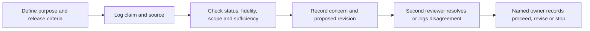

# Computational Skepticism for AI Pilot Assurance: A Claim-Level Review and Workshop Protocol

Humanitarians AI | Rough methods manuscript | November 2026

## Abstract

Teams deciding whether an AI pilot should proceed need to know precisely which assertions are supported and which require revision. We propose a claim log, independent evidence review, and a staff tabletop exercise for scoring errors without rewarding indiscriminate rejection. This document is a proposed protocol, not a validated training program.

## Methods

**Figure 1.** Proposed process. For each claim record the exact assertion, source location and version where available, check date, reason and disposition. A required claim whose evidence cannot be checked stays unresolved until removed, corrected, or verified.

In a fictional library example, 40 completed room-reservation forms have a median completion time of seven minutes. Incomplete forms are excluded and there is no prior comparison. Ask reviewers to distinguish the correct statement from three errors: substituting 400, generalizing to all started forms, and asserting that a new form caused a speedup. A second scenario covers withdrawn sources, summaries that repeat a withdrawn claim, and an unrelated corrected source as a control.

Compare ordinary source review with structured review on matched but distinct scenario sets. Randomize or counterbalance order. Assessors blind to the condition score a frozen answer key. Prespecify material defects detected and supported claims wrongly rejected per reviewer; also collect completion time and whether a second reviewer can reproduce the disposition. Analyze at reviewer level, not as if all judgments were independent.

## Related work and companion applications

[NIST's AI Risk Management Framework](https://www.nist.gov/itl/ai-risk-management-framework) provides organizational context. NIST's [evaluation-probe demonstrator](https://github.com/usnistgov/agentic-research-evaluation-probes) separates fidelity, completeness and sufficiency; it is a research precedent, not validation of our protocol. People retain sign-off authority.

The [Disease, Syndromes and Symptoms](https://github.com/nikbearbrown/disease-syndromes-and-symptoms-lexicon/tree/main/paper) and [Clinical Treatments and Procedures](https://github.com/nikbearbrown/clinical-treatments-and-procedures-lexicon/tree/main/paper) companion papers each show Social Media Agent and Research Ledger. Fictional outputs from these could provide additional exercises on coverage gaps and relevance versus strength of evidence. The initial workshop requires neither agent nor any live or protected data.

## Status and limitations

No participants have been recruited and no efficacy is claimed. Fictional scenarios test defined reasoning tasks, not everyday error rates or operational safety. Any later participant study requires appropriate institutional review before recruitment. This protocol does not replace agency policy or establish certification.
